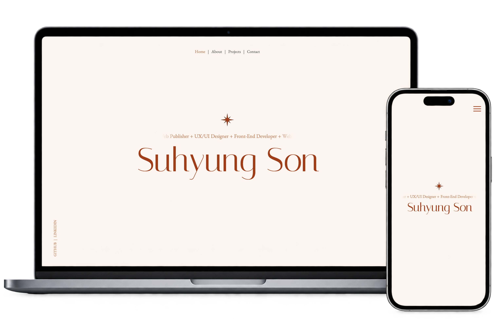

# Suhyung Son — Personal Portfolio

A responsive and interactive portfolio website showcasing my work in front-end development, web publishing, and UI/UX design.

Designed in Figma and implemented using HTML, CSS, and JavaScript.

🌐 [**Live Website**](https://suhyung-son.github.io/)　|　🎨 [**Figma Design**](https://www.figma.com/design/D0elnFkUNNoSoGmQbZLBGe/portfolio?node-id=160-2&t=FlFmVKRJzTUVFmHi-1)

---

## 📸 Preview



## 📌 About This Project

This portfolio was designed and developed to showcase my professional experience, technical skills, and selected projects.

Built without front-end frameworks, it focuses on responsive layouts, custom UI animations, and scroll-based interactions to create an engaging and intuitive browsing experience.

## 🛠 Tech Stack


- **Development:** HTML5, CSS3, Vanilla JavaScript
- **Design:** Figma
- **Deployment:** GitHub Pages

## ✨ Key Features

- **Responsive Design** — Layouts adapted for desktop and mobile screens.
- **Scroll-Driven Interactions** — Dynamic animations and visual transitions that respond to user scrolling.
- **Interactive Project Previews** — Image previews that highlight selected projects.
- **Skill Visualization** — Custom donut charts displaying technical skills.

## 🎨 Design & Development

The entire website was designed in Figma and implemented with HTML, CSS, and JavaScript.

The focus was on combining visual design with functional front-end development, using custom animations and interactive elements to create a distinctive portfolio experience.

## 📂 Project Structure

```text
├── index.html
├── css/
├── js/
├── img/
└── README.md
```

## 📬 Contact

Feel free to reach out via email!

📧 [**Email Me**](mailto:suhyungsonn@gmail.com)

---

*Designed & Developed by Suhyung Son*
